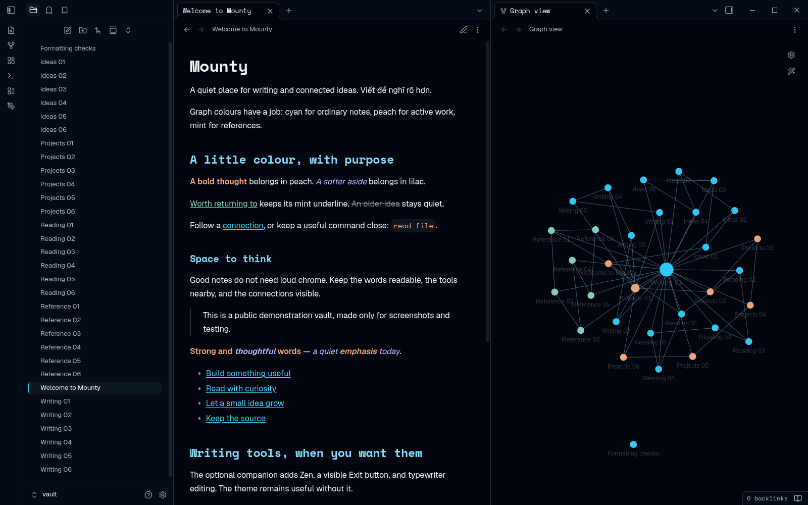
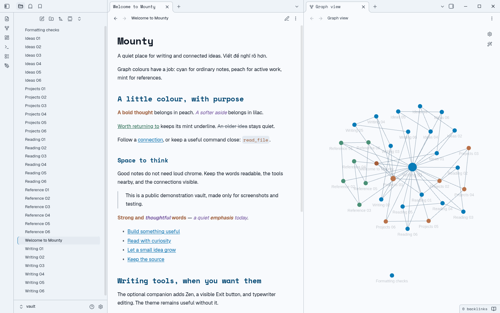
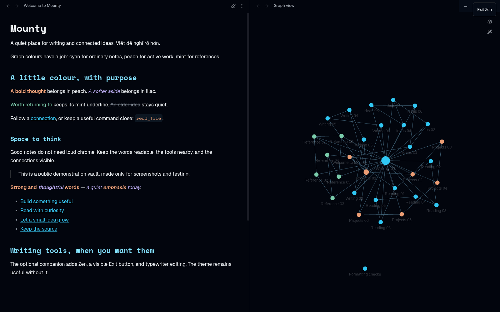

# Mounty

Mounty and the supported community alias **Omarchy** offer the same quiet, colourful Obsidian theme for writing and connected thinking. At matching releases their CSS is byte-identical, with the same dark/light palettes and capabilities. Staying on Omarchy is fully supported; changing names is optional. Geist keeps prose readable; Space Mono gives headings and code a distinct voice.

Colour has a job: peach bold and inline code, lilac italic, mint underline, quiet slate strikethrough and cyan links. The graph follows a small, explicit colour system—not a different accent for every folder.

## Two names, one theme — submission status

**Omarchy remains a supported equal installation route**, not a frozen edition
or a redirect. Its existing community updater keeps the name Omarchy and the
same appearance/features as Mounty at a matching release. No migration is needed
to get this design. Root/updater metadata is **Omarchy 1.7.1**; the explicit
manual package is **Mounty 1.7.1**.

**New Mounty and Mounty Zen community listings are planned, not submitted or
approved.** Until a listing/version is actually available, use the reviewed
manual packages when released. See [optional migration](docs/MIGRATING-TO-MOUNTY.md) and the
[listing/source-export guide](docs/COMMUNITY-LISTINGS.md). No new repository or
listing URL is claimed here. Theme updates never auto-install the optional plugin.

## See it in Obsidian



*Dark: light text on a near-black canvas, with colour reserved for emphasis and connections.*



*Light: the same layout with a pale canvas and darker reading accents.*

These are real Obsidian captures, not mockups. All notes are synthetic. The graph's two custom Groups were configured manually: peach active work, mint references, and cyan ordinary notes. The theme does not classify notes or create Groups.

## A little colour, a familiar workspace

- **Geist prose, Space Mono headings/code.** Original Latin/Vietnamese font subsets and their OFL notices are embedded for offline use; explicit user font overrides still apply.
- **Selected emphasis, not a syntax rainbow.** Ordinary bold, italic, HTML underline, strikethrough and inline code have distinct roles. Fenced code keeps its syntax colours, headings retain their hierarchy, and formatted links remain cyan.
- **Comfortable reading.** Neutral surfaces, soft controls, preferred text-size scaling, about 68ch readable width and 1.7 leading, without replacing Obsidian's native layout.
- **A meaningful graph.** Native semantic colours and an optional three-colour Group recipe. No automatic taxonomy, note rewriting or graph-physics changes.
- **Scoped compatibility styling.** File explorer/Outline indicators and existing Maps, Note Toolbar, Omnisearch, QuickAdd and TaskNotes styling. See version-specific [compatibility notes](COMPATIBILITY.md), not a promise about every plugin or snippet.

**The theme works on its own.** Mounty Zen is an optional companion, not a requirement for ordinary reading or emphasis colours.

## Install or update

### Existing community installation: Omarchy

The current community listing and updater remain **Omarchy**, an equal supported alias. Find or update Omarchy in **Settings → Appearance → Themes**, check the available version, and keep Omarchy selected if using that route.

The root `manifest.json` deliberately retains `name: Omarchy`, matching the `Omarchy/` folder. Its 1.7.1 CSS is byte-identical to the manual Mounty package. The repository URL/community entry are unchanged; a new Mounty listing is only planned. You do not need to switch names for the design or writing tools.

### Mounty-named manual installation

When the reviewed 1.7.1 assets are published on the [existing repository Releases page](https://github.com/sonlndv/obsidian-omarchy-theme/releases), use **Mounty-1.7.1.zip**. This source update does not claim that upload has happened. Extract its **Mounty/** folder under `<vault>/.obsidian/themes/`, so `theme.css` and `manifest.json` sit directly in `.obsidian/themes/Mounty/`. Select **Mounty** in Appearance, then choose Light, Dark or Adapt to system.

The package's manifest name matches its folder. Do not copy the root Omarchy manifest into a Mounty folder or mistake a source ZIP for the manual package. Keep the old Omarchy folder/release until the new selection is verified. For later manual updates, replace only Mounty's public theme files; do not reset notes or preferences.

**Already using an Omarchy desktop hook?** Review/update it before switching to Mounty. A legacy bulk hook can write/select Omarchy again. Use the deliberate policy setup below rather than assuming the old hook protects your selection.

### Optional companion: Mounty Zen 0.4.1

Use **omarchy-writing-0.4.1.zip** and the [companion guide](companion/README.md). The stable ID/folder remains **omarchy-writing**.

For an upgrade, disable the companion, replace `main.js`, `styles.css` and `manifest.json` in the same folder, retain `data.json`, then explicitly re-enable it. Do not create a second plugin ID for the new display name. The theme updater does not install, update or enable the companion.

## Writing tools, when you want them

Click the pen ribbon or use **Mounty Zen: Open writing tools**. The native menu provides Zen, optional typewriter editing, Outline and Backlinks. Opening a pane is explicit and exits Zen first; no pane opens at startup. There are no default hotkeys—assign your own in Settings → Hotkeys if wanted.


Zen starts OFF and hides surrounding navigation without collapsing panels or saving a new layout. A visible **Exit Zen** button remains available; menus and native dialogs keep their own Escape handling. Typewriter scrolling acts only on a focused, unselected cursor in Zen source editing, not reading mode or an idle loop.



Optional preferences also cover narrow/standard/wide Markdown width and hiding the inline filename title. Existing preferences are preserved during an update; the companion does not read/write note content, Graph Groups, other plugin settings, hotkeys or layout.

## Follow desktop Omarchy colours—optional

The default is **fixed Mounty colours, Follow Omarchy colours OFF**. In **Settings → Mounty Zen**, OFF immediately protects the fixed dark/light emphasis, headings and graph roles, including when loaded CSS was generated from a live Omarchy palette. It affects only the recognized theme, not another selected theme.

ON permits the **next normal desktop Omarchy theme application** to supply live colours. The switch does not rebuild CSS now, execute shell, change the OS theme or guarantee phone sync. Update both the theme and companion for the new protected emphasis roles; Writing 0.3 keeps its older protected palette.

For an explicitly policy-targeted vault, a selected Mounty theme keeps its **Mounty/** destination and matching manifest/selection when ON. A selected Omarchy target stays Omarchy. OFF, missing/invalid/non-boolean preferences, unsupported selections and unsafe destinations fail closed for that named vault. Only literal boolean `true` opts in.

### Deliberate desktop hook setup

This is optional setup for Omarchy users—not a one-vault preview or an automatic installer.

1. Back up an existing `50-obsidian-theme` wrapper **outside** the executable hook directory, for example under `~/.local/state/omarchy-hook-backups/`. Retain the owned theme/runtime/preferences for rollback too.
2. Copy this repository's reviewed `hooks/50-obsidian-theme` to a staging file outside that directory. Review its source/build path and set `--policy-vault` to your deliberate **absolute registered vault path**. Keep `--live --install --policy-vault` together; do not change other hooks.
3. Install the reviewed staging wrapper through the supported runner:

   ```sh
   omarchy hook install theme-set /absolute/path/to/reviewed/50-obsidian-theme
   ```

4. Keep Follow Omarchy colours OFF first. Verify the enabled companion, selected theme and setting. Opt in only when wanted; the next normal desktop theme application supplies the live palette.

The wrapper retains `$HOME/code/obsidian-omarchy-theme/bin/build.py`; no repository move is required. Backups must stay outside the executable hook directory: the runner invokes regular files except `*.sample`, so `.disabled` or removing executable bits is not a reliable toggle. No curl-to-shell command is needed.

**Important legacy behaviour:** without `--policy-vault`, `--live --install` updates/selects Omarchy in **all registered vaults**. Even with the flag, other registered vaults keep that legacy behaviour; only the named vault is opt-in. This is not a globally opt-in or single-vault installer. Policy checks re-read inputs and paths after assembly, but are not an atomic filesystem transaction. Stop on concurrent changes during deployment.

## A small, rule-based graph palette

Use one axis: **the note's role in your workflow**. Start with only three note colours:

| Meaning | Optional native Group rule | Dark / light |
| --- | --- | --- |
| Ordinary notes | Default when no specific rule matches | cyan `#39d0fc` / `#006cac` |
| Active work | `tag:#active`, first | peach `#f5a67d` / `#96502a` |
| Sources / reference | `tag:#reference`, after active | mint `#83d5b4` / `#22684e` |

**The first matching native Group wins:** active → reference → ordinary. A note matching both tags is peach when active is first. Keep the same meaning across the vault; a completed project should not stay peach merely because it lives in a Projects folder. Use a short legend and deliberate real queries. More colour needs another useful distinction, not just an available swatch.

These tags are examples, not assumptions about your notes. Native custom Group colours do not automatically remap when switching dark/light; choose the paired swatch deliberately. The theme never creates tags or Groups, classifies notes, or changes `graph.json`, physics or zoom.

Without custom Groups, native roles remain cyan notes, peach focus/highlight, mint tags, lilac attachments and quieter stone unresolved links. Show tags/attachments only when useful; focus is temporary emphasis, not saved active-work status. Lilac and stone are not extra arbitrary topic colours in the three-colour example. Read the [full graph colour principles](docs/GRAPH-COLOURS.md).

## Formatting details and limits

Native Live Preview HTML `<u>` and ordinary underline spans use mint; formatted links stay cyan and headings keep their role. Both views preserve bold weight and italic style. Live Preview flattens combined nesting into `.cm-em.cm-strong`, which is lilac in either order; reading mode preserves nesting, so `strong > em` is lilac and `em > strong` peach. This difference is documented, not recovered by parsing notes.

Unresolved stone nodes retain 0.8 opacity. Their composited contrast is checked at ≥3:1 in both schemes; this is not a full accessibility certification or a claim that every faded graph label meets that threshold.

Native formatting was exercised in Obsidian 1.14.5 in an isolated synthetic desktop vault, in both schemes and editing/reading, with the theme alone and companion protection over live-generated CSS. Main-window behaviour is the target. Detached editors, physical iPhone, mobile keyboard/touch/IME and remote sync are not certified. Older SDKs may lack command/settings notifications; unavailable actions remain disabled. See [COMPATIBILITY.md](COMPATIBILITY.md) and [CHANGELOG.md](CHANGELOG.md).

## Development

```sh
python3 -B bin/build.py
python3 -B bin/package_theme.py
python3 -B bin/package_companion.py
python3 -B bin/package_submissions.py
python3 -B -m unittest discover -s tests -v
node --check companion/main.js
node --test tests/test_companion.cjs
```

Default output remains root Omarchy 1.7.1. The deterministic packagers create `dist/Mounty-1.7.1.zip` and `dist/omarchy-writing-0.4.1.zip` using public-file allowlists. The source exporter creates two separate, root-ready
submission archives with product-specific READMEs and correct manifests; see
[the submission guide](docs/COMMUNITY-LISTINGS.md). The measured source palette in `src/sonwork/palette.json` stays separate from Mounty's derived emphasis/graph roles.

The [native formatting probe](tests/NATIVE-FORMATTING.md) requires an explicit synthetic vault and fixed sample file, then checks actual DOM colours/styles. Native execution is separate from CI: Python discovery checks source consistency, Node syntax and identity guards; hosted CI does not launch Obsidian.

## Rollback and licences

Disable the companion before restoring its backed-up runtime; retain `data.json`. Restore the owned theme files and select the retained Omarchy release/folder, keeping Mounty until the fallback is verified. Restore the exact reviewed hook backup through the host's normal maintenance process if needed. Older hook/companion pairs may not enforce opt-in; verify the full rollback combination before allowing desktop writes. Never reset notes, Groups, other plugin settings, hotkeys or layout.

MIT: [LICENSE](LICENSE). Original [Geist](OFL-Geist.txt) and [Space Mono](OFL-SpaceMono.txt) copyright/OFL notices accompany both theme distributions and remain readable inside self-contained CSS. Public archives contain no private settings, fixture notes, logs or third-party plugin packages.
