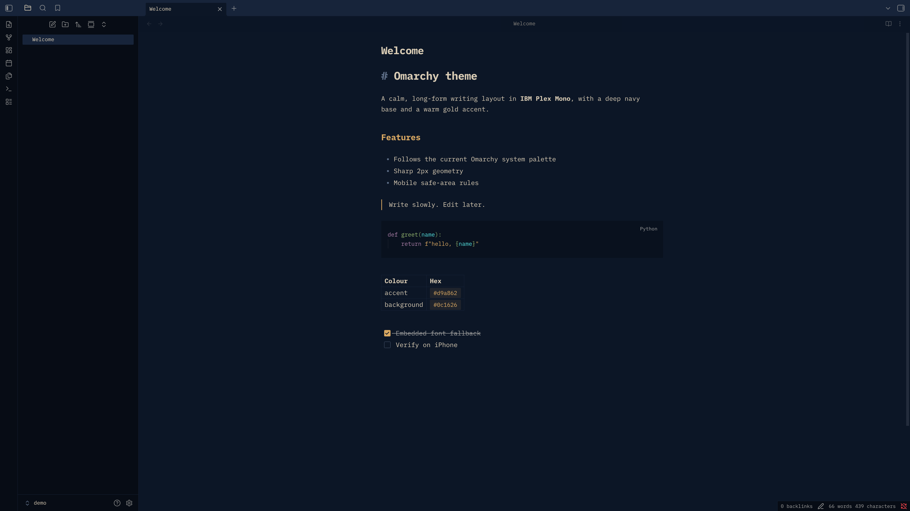

# Omarchy theme for Obsidian

An Obsidian theme built from an Omarchy colour palette (`src/colors.toml`),
with IBM Plex Mono embedded, a long-form writing layout and sharp edges.

## Build

    python3 bin/build.py

Writes `theme.css` and `manifest.json` to the repo root (both are committed).
Options: `--live` reads the current Omarchy theme colours instead of
`src/colors.toml`; `--install` also copies the result into every vault listed
in `~/.config/obsidian/obsidian.json` and selects the theme.

Tests: `python3 -m unittest discover -s tests`

## Install

Copy `theme.css` and `manifest.json` into `<vault>/.obsidian/themes/Omarchy/`,
then choose **Omarchy** under Settings → Appearance → Themes.

## iPhone

Once listed in the community directory, install from Settings > Appearance >
Themes > Manage. The mobile rules (safe-area padding, 17px editor text) are
untested on iOS until verified.

## License

MIT. See [LICENSE](LICENSE).
